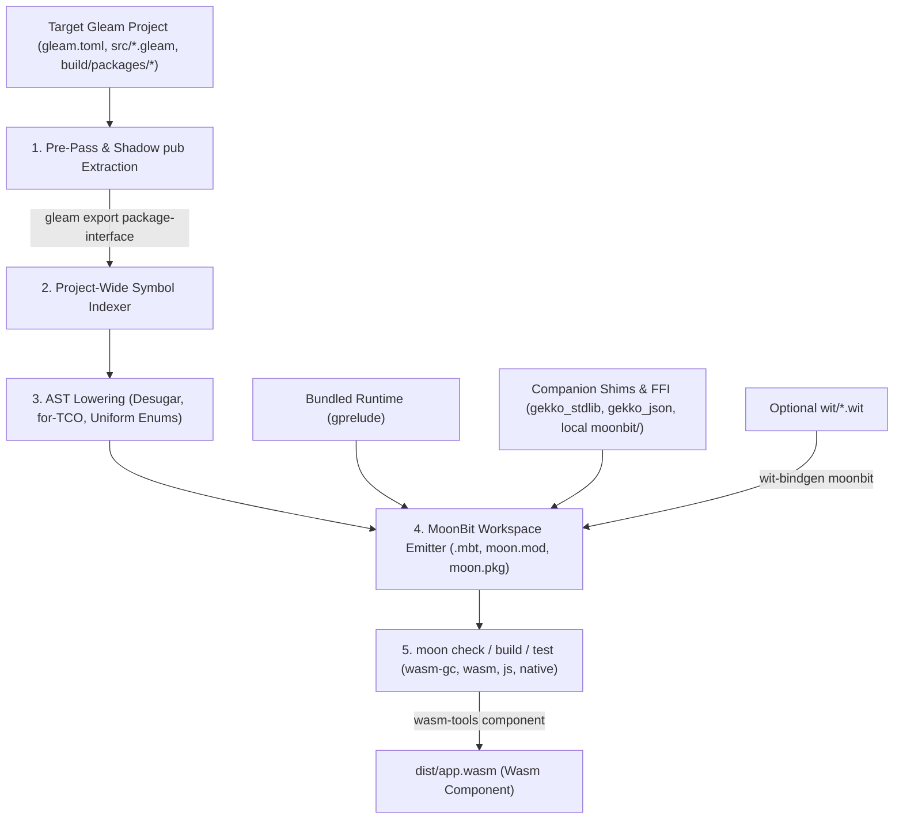

# `gekko` (月光)

**A Gleam-to-MoonBit transpiler and WebAssembly Component compiler.**

`gekko` (from Japanese *月光*, meaning *moonbeam*) compiles standard Gleam projects—including local modules and resolved Hex dependencies—into multi-package [MoonBit](https://www.moonbitlang.com/) workspaces. From there, MoonBit compiles your Gleam code to **`wasm-gc`**, **`wasm`** (linear memory), **`js`**, **`native`**, and **WebAssembly Components (WIT / WASI Preview 2)**.

> [!WARNING]
> **Experimental Software — Not Production Ready:** `gekko` is an early-stage, experimental transpiler and is **not yet suitable for production use**. CLI flags, FFI conventions, generated MoonBit code, runtime semantics, and compatibility with upstream Gleam and MoonBit releases may change without notice, and bugs or unsupported edge cases should be expected.

---

## Why `gekko`?

- **Keep standard Gleam tooling:** Target projects stay 100% valid Gleam. `gleam check`, `gleam test`, and `gleam format` continue to work without modification.
- **Target WebAssembly & native via MoonBit:** Leverage MoonBit's compact, fast codegen across `wasm-gc`, linear `wasm`, JavaScript, and native binaries without maintaining a custom code generator or GC runtime.
- **Zero-boilerplate Wasm Component Model:** Generate WIT bindings via `wit-bindgen moonbit` and bundle WASI Preview 2 components with `wasm-tools`.
- **Standard library & JSON support:** Transpile unmodified upstream Hex [`gleam_stdlib`](https://hex.pm/packages/gleam_stdlib) and [`gleam_json`](https://hex.pm/packages/gleam_json) paired with companion shim overlays [`gekko_stdlib`](https://github.com/spiral-nights/gekko_stdlib) and [`gekko_json`](https://github.com/spiral-nights/gekko_json) (`patches/` backed by `Map`, `@json.Json`, `Bytes`) with faithful Gleam semantics (see [`docs/SEMANTICS.md`](./docs/SEMANTICS.md) for documented differences).

---

## Architecture Overview



### Core Design Highlights

1. **Shadow `pub` Type Resolution:** To satisfy MoonBit's requirement for explicit top-level function type annotations without re-implementing Hindley-Milner inference, `gekko` stages a shadow copy of source files with private declarations temporarily promoted to `pub`, invokes `gleam export package-interface`, and gets exact compiler-inferred signatures for every function. MoonBit handles local type inference inside function bodies.
2. **Uniform Enums & Uniform Getters:** Every Gleam custom type—single-variant or multi-variant—compiles to a MoonBit `pub(all) enum` with synthesized `.field()` getter methods, eliminating constructor/pattern syntax splits and receiver-type ambiguity at dot-access sites.
3. **Functional `for` Loop TCO:** Self-tail-recursive Gleam functions lower to MoonBit functional `for` state loops (`for a = a, b = b { ... => continue ... }`), guaranteeing $O(1)$ stack space across all MoonBit targets (`wasm-gc`, `wasm`, `js`, `native`).
4. **Persistent Lists (`GList[T]`):** Gleam `List(a)` maps to a persistent singly-linked `@prelude.GList[T]` (`Nil` / `Cons`) instead of MoonBit's mutable `Array[T]`, preserving $O(1)$ prepends and pattern deconstruction.
5. **Companion Shim Overlays (`gekko_stdlib` & `gekko_json`):** Instead of hardcoding standard-library or JSON shims inside the compiler or maintaining forks, `gekko` transpiles unmodified upstream [`gleam_stdlib`](https://hex.pm/packages/gleam_stdlib) and [`gleam_json`](https://hex.pm/packages/gleam_json) from `build/packages/`, applying co-located `patches/` (`#gekko.patch`) MoonBit implementations from [`gekko_stdlib`](https://github.com/spiral-nights/gekko_stdlib) and [`gekko_json`](https://github.com/spiral-nights/gekko_json).

---

## Installation

**Prerequisites:**
- **[Gleam](https://gleam.run)** `1.19.x` (verified with `1.19.2`) and Erlang/OTP (27/28) on your `PATH`
- **[MoonBit](https://www.moonbitlang.com/)** (`moon >= 0.1.20261104` / `moonc >= 0.10.20`; verified with `moon 0.1.20261119` / `moonc v0.10.22`, pinned in [`.moonbit-version`](./.moonbit-version); required for the `moon.mod` / `moon.pkg` manifest format that `gekko` emits)
- **`wasm-tools` and `wit-bindgen`** (`wit-bindgen-cli`) — needed only for WebAssembly Component (`gekko wit`) commands

```bash
git clone https://github.com/spiral-nights/gekko && cd gekko
scripts/install.sh            # installs to ~/.local/bin/gekko
scripts/install.sh /some/bin  # or choose another directory (must be on PATH)
```

The script runs `gleam export erlang-shipment`, copies the standalone shipment to `~/.local/share/gekko/erlang-shipment` (override via `GEKKO_INSTALL_DIR`), and writes a `gekko` launcher into the bin directory. You can call `gekko` from any directory, `--root`/`--work-dir`/`--output` resolve relative to your current directory, and moving or deleting the source checkout will not break the installed binary. Re-run `scripts/install.sh` after pulling or changing `gekko`'s source.

Without installing, you can still run `gleam run -- <command>` from the repository, or verify your toolchain with `gekko doctor`.

---

## Quick Start

```bash
gekko new hello_gekko
cd hello_gekko
gekko run                  # auto-downloads deps, transpiles to MoonBit, and runs
gekko build --release      # emits portable WASI hello_gekko.wasm (runs in wasmtime)
```

For a WebAssembly Component starter project:

```bash
gekko new hello_wit --wit
cd hello_wit
gekko wit check
gekko wit build --release  # outputs dist/app.wasm
```

---

## Project Setup (`gleam.toml`)

Target projects depend on unmodified upstream Hex `gleam_stdlib` (and `gleam_json`, if used) alongside their companion shim packages, and explicitly enable them under `[tools.gekko.use_shims]` in `gleam.toml`:

```toml
[dependencies]
gleam_stdlib = ">= 1.0.0 and < 2.0.0"
gleam_json = ">= 3.0.0 and < 4.0.0"
gekko_stdlib = { git = "https://github.com/spiral-nights/gekko_stdlib.git", ref = "main" }
gekko_json = { git = "https://github.com/spiral-nights/gekko_json.git", ref = "main" }

[tools.gekko.use_shims]
gleam_stdlib = "gekko_stdlib"
gleam_json = "gekko_json"
```

Your application and transitive Hex dependencies resolve against standard upstream `gleam_stdlib` and `gleam_json`, while `gekko` applies the enabled companion shims' `patches/` during MoonBit transpilation. See **[`docs/GUIDE.md`](./docs/GUIDE.md)** for the full authoring walkthrough.

---

## CLI Usage

```bash
# Scaffold a new project (or initialize in an existing directory)
gekko new <name> [--wit]
gekko init [--root <dir>] [--wit]

# Verify required & optional toolchain binaries (gleam, moon, moonc, wit-bindgen, wasm-tools).
# Prints WARN when the installed MoonBit toolchain is newer than the verified pinned version.
gekko doctor

# Remove generated build/moonbit and staging directories
gekko clean [--root <dir>]

# Type-check transpiled MoonBit output for a Gleam project (--root defaults to `.`)
gekko check [--target <wasm|wasm-gc|js|native>] [--root <dir>] [--work-dir <dir>]

# Transpile and build targeting wasm (default, WASI Preview 1), wasm-gc, js, or native.
# Writes the compiled artifact (<name>.wasm / .js / .exe) into the current
# directory by default (or to --output / -o), keeping intermediates in build/moonbit.
gekko build [--release] [--target <wasm|wasm-gc|js|native>] [--root <dir>] [--output <file> | -o <file>] [--work-dir <dir>]
gekko build --target wasm
gekko build --target wasm-gc
gekko build --target js
gekko build --target native -o myfile.exe
gekko build --release --target wasm   # optimized, much smaller output

# Run tests or execute `main()` (forwarding program args after `--`)
gekko test [--target <wasm|wasm-gc|js|native>] [--root <dir>] [--work-dir <dir>]
gekko run  [--target <wasm|wasm-gc|js|native>] [--root <dir>] [--work-dir <dir>] [-- <args>...]

# Generate Gleam FFI stubs + MoonBit adapter from a MoonBit package (.mbti)
gekko moonbit bind <pkg> [--root <dir>] [--module <gleam_mod>] [--work-dir <dir>]

# Inspect unmapped FFI in a dependency or scaffold a companion shim package
gekko shim inspect <pkg> [--root <dir>]
gekko shim init    <pkg> [--root <dir>] [--out <dir> | -o <dir>]

# Generate WIT bindings, type-check, and bundle a Wasm Component (WIT / WASI Preview 2)
gekko wit gen   [--root <dir>] [--wit <dir>] [--world <name>]
gekko wit check [--root <dir>] [--wit <dir>] [--world <name>] [--work-dir <dir>]
gekko wit build [--release] [--root <dir>] [--wit <dir>] [--world <name>] [--output <file.wasm> | -o <file.wasm>]

# Show version or help
gekko --version
gekko --help
```

*(Note: `--out` is accepted as a backwards-compatible alias for `--work-dir` across commands and `-o` on `build`.)*

---

## WebAssembly Targets & Runtime Compatibility

`gekko` supports three distinct WebAssembly output modes:

1. **`gekko build` (`--target wasm`, default) — Standard WASI Preview 1:**
   Emits a linear-memory module importing `wasi_snapshot_preview1::fd_write` and exporting `_start`, so pure-Gleam programs run directly in standard WASI runtimes (`wasmtime`, `wasmer`, `wazero`, `moonrun`).
2. **`gekko build --target wasm-gc` — Compact WasmGC:**
   Uses the host's garbage collector with no linear memory, importing `spectest::print_char(i32)` for stdout (`println` / `echo`). Run it with `moonrun` / `gekko run --target wasm-gc`, or in browsers/Node/Deno/Bun by passing a small JS import shim:
   ```js
   let line = "";
   const { instance } = await WebAssembly.instantiateStreaming(fetch("app.wasm"), {
     spectest: {
       print_char(ch) {
         if (ch === 10) { console.log(line); line = ""; }
         else { line += String.fromCharCode(ch); }
       },
     },
   });
   instance.exports._start();
   ```
3. **`gekko wit build` — WASI Preview 2 / Component Model:**
   Compiles linear-memory Wasm with `wit-bindgen` + `wasm-tools` into a typed `.wasm` component for `wasmtime` and other Component Model hosts.

> [!NOTE]
> MoonBit OS/runtime FFI packages such as `moonbitlang/core/env`, `moonbitlang/x/fs`, `moonbitlang/core/bench`, and `moonbitlang/async` emit MoonBit-specific Wasm host imports (`__moonbit_fs_unstable`, `__moonbit_time_unstable`, `__moonbit_sys_unstable`, `moonbitlang/async`) that require `moonrun` on Wasm targets. For portable host I/O across Wasm runtimes, use `gekko wit` (or target `native` / `js`).

---

## WebAssembly Components (`gekko wit`)

Compile a Gleam library or application against a [WIT (WebAssembly Interface Types)](https://component-model.bytecodealliance.org/design/wit.html) schema (`wit/*.wit`) and package it into a **WASI 0.2 / Component Model** `.wasm` component:

```bash
gekko wit gen               # generates src/wit/*.gleam bindings + starter src/<iface>.gleam stubs
gekko wit check             # transpiles, runs wit-bindgen moonbit, and type-checks
gekko wit build --release   # bundles dist/<world>.wasm via wasm-tools
```

Prerequisites for `gekko wit`: [`wit-bindgen`](https://github.com/bytecodealliance/wit-bindgen) (`gekko wit check` / `build`) and [`wasm-tools`](https://github.com/bytecodealliance/wasm-tools) (`gekko wit build`). See **[`docs/GUIDE.md`](./docs/GUIDE.md#5-building-a-webassembly-component-gekko-wit)** for the full workflow and file ownership rules.

---

## MoonBit FFI & Companion Shims

- **Bind existing MoonBit packages:** Declare dependencies in `moonbit/moon.mod` and run `gekko moonbit bind <pkg>` to generate `src/ffi/<pkg>.gleam` and any needed `moonbit/<pkg>_adapter/`.
- **Write custom MoonBit FFI:** Place `.mbt` packages under `moonbit/<pkg>/` and bind them with `/// @external(moonbit, "<pkg>", "<fn>")` / `/// @external_type(moonbit, "<pkg>", "<Type>")` so standard `gleam check` stays green. Add `"gekko/gprelude@0.1.0"` to `moonbit/moon.mod` and `"gekko/gprelude" @gprelude` to `moon.pkg` for automatic `moon.work` LSP support.
- **Shim unmodified Hex packages:** Use `gekko shim inspect <pkg>` and `gekko shim init <pkg>` to scaffold a companion shim with `[tools.gekko.shim_for]` and `patches/<mod>/` (`#gekko.patch`), then enable it in your app's `[tools.gekko.use_shims]`.

See **[`docs/GUIDE.md`](./docs/GUIDE.md)** for step-by-step authoring recipes and **[`docs/SHIMS.md`](./docs/SHIMS.md)** for the full shim configuration reference.

---

## Supported Gleam Version

`gekko` targets **Gleam 1.19.x** (verified with `gleam 1.19.2`) and parses Gleam syntax via `glance >= 7.0.0 and < 8.0.0` / `glexer >= 2.5.0 and < 3.0.0`, delegating type-checking and package-interface extraction to the installed `gleam` compiler.

---

## Examples

Standalone example projects are hosted in [`gekko_examples`](https://github.com/spiral-nights/gekko_examples):

- **Orbital Station** — Pure Gleam language tour (basics, TCO loops, records, `echo`, stdlib)
- **Weather App** — `gleam/json` & `gleam/dynamic/decode` with custom forecast records
- **WIT Greeter** — Minimal Wasm Component (`wit/world.wit`, `gekko wit gen`, `wit check`, `wit build`)
- **MoonBit FFI** — Local `moonbit/` package and `moonbitlang/core/math` via `@external`
- **File I/O** — Reading/writing files via `moonbit/moon.mod` (`moonbitlang/x/fs`) + `gekko moonbit bind`
- **Fibonacci CLI** — Reading CLI arguments via `moonbitlang/core/env` + native `gekko build --target native`
- **Calculator** — Multi-statement expression & function evaluator using the pure-Gleam `party` parser combinator package from Hex

---

## Project Documentation

- **[`docs/GUIDE.md`](./docs/GUIDE.md)** — Authoring guide: apps, MoonBit FFI, LSP setup (`moon.work`), companion shims, WIT components, and `@gprelude` type cheat sheet.
- **[`docs/SHIMS.md`](./docs/SHIMS.md)** — Companion shim & overlay reference (`[tools.gekko.use_shims]`, `[tools.gekko.shim_for]`, `patches/` + `#gekko.patch`, `[tools.gekko.target_branch]`, `gekko shim`).
- **[`docs/SPEC.md`](./docs/SPEC.md)** — Full architectural specification, lowering rules, runtime design, and WIT bridge details.
- **[`docs/SEMANTICS.md`](./docs/SEMANTICS.md)** — Runtime semantics, target behavior, and documented differences from Erlang/JS Gleam.
- **[`docs/ROADMAP.md`](./docs/ROADMAP.md)** — Phased implementation plan, deliverables, and verification gates.
- **[`docs/GLEAM_SYNTAX_MAP.md`](./docs/GLEAM_SYNTAX_MAP.md)** — Complete mapping from `glance` AST nodes to MoonBit lowering rules.
- **[`LICENSE`](./LICENSE)** — MIT License.

## Release Output Sizes

Measured with `gekko 0.1.0` (`gleam 1.19.2`, `moon 0.1.20261119`) using `--release` on a minimal `hello` app (`echo "Hello, gekko!"`) and a minimal WIT greeter component (`export greet: func(name: string) -> string`):

| Target | Command | Output Size |
| :--- | :--- | :--- |
| `wasm-gc` | `gekko build --release --target wasm-gc` | `4.7 KiB` (4,767 bytes) |
| `wasm` (linear) | `gekko build --release --target wasm` | `9.2 KiB` (9,375 bytes) |
| `js` | `gekko build --release --target js` | `4.8 KiB` (4,902 bytes) |
| `native` | `gekko build --release --target native` | `389 KiB` (397,600 bytes) |
| Wasm Component (WIT) | `gekko wit build --release` | `3.3 KiB` (3,353 bytes) |

---

## Known Limitations

- **Fixed-width 64-bit `Int`s and runtime differences:** Gleam `Int` maps to signed 64-bit `Int64` with wrapping overflow rather than Erlang arbitrary-precision integers (or JS 53-bit safe integers). See [`docs/SEMANTICS.md`](./docs/SEMANTICS.md) for the full list of documented differences.
- **Testing MoonBit FFI code:** `gleam test` runs on Erlang/JS and cannot execute `@external(moonbit, ...)` functions unless they also provide an Erlang/JS external or pure-Gleam fallback. Use `gekko test` to transpile and run tests on MoonBit targets.
- **Mutual tail recursion & exported WIT resources:** Self-recursive tail calls are lowered to MoonBit `for` loops, while mutually recursive functions are not yet tail-call optimized. Imported WIT `resource` handles (`own<T>`, `borrow<T>`) are supported, while exported WIT resources are not yet supported.

## Contributing

Contributions are welcome! Before opening a pull request:

```sh
gleam format --check src test
gleam check
gleam test
```

- If you edit `runtime/prelude/gprelude.mbt` or `runtime/prelude/moon.pkg`, run `./scripts/sync_prelude.sh` so `src/emit/prelude_runtime.gleam` stays byte-identical.
- To run the full downstream regression suite across `gekko_stdlib`, `gekko_json`, and `gekko_examples`, run `./scripts/test_ecosystem.sh`.
- CI installs the MoonBit toolchain pinned in `.moonbit-version`. When bumping the verified version, update both `.moonbit-version` and `pinned_moon_version` / `pinned_moonc_version` in `src/project/cmd.gleam` (a test enforces they match). A separate scheduled `moonbit-latest` CI job runs against the newest MoonBit release to surface breaking changes early.

## AI Usage

AI-assisted development tools are used in this project and are welcome for contributions. All code and documentation—whether human-written or AI-assisted—must pass the project's formatting and test checks (`gleam format --check src test` and `gleam test`) and be reviewed for correctness.
